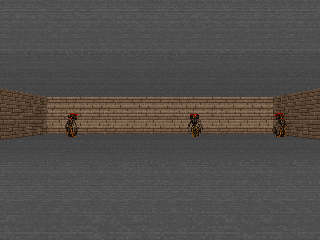

<h1 align="center">doom-esn</h1>

<p align="center"><i>how little memory does a Doom agent need?</i></p>

<p align="center">
A CPU-only agent that learns to play <a href="https://github.com/Farama-Foundation/ViZDoom">ViZDoom</a>,
and a measured study of one question:
</p>

<p align="center">
<b>Given a fixed budget of <code>B</code> bytes of resident memory, how should the agent store its past so that it still plays well?</b>
</p>

<p align="center">
<a href="mailto:salujavrinda018@gmail.com">salujavrinda018@gmail.com</a> ·
<a href="https://www.linkedin.com/in/vrinda-saluja-rl/">LinkedIn</a>
</p>

<p align="center">

</p>

The short answer: on `VizdoomTakeCover` a **384-byte** state of two frames matches anything we
tried, and the 1600-byte reservoir does no better than a **uniform-random policy** (244). Once a
memory works, shrinking it is nearly free: an 8-bit state of **48 bytes** matches the raw
reservoir's return (237 vs 238) and the whitened reservoir's measured memory (R² 0.180 vs 0.181),
so 48 bytes buys what 1600 bytes does. A 1-byte codebook is where the capacity finally drops. The
caveat matters as much as the result: TakeCover rewards reacting to the current frame, so a short
delay line carries the whole signal and a recurrent state buys nothing. What this repo actually
contributes is the **method**: a shared-latent benchmark that fits every memory in seconds, and a
probe that measures memory directly instead of inferring it from noisy return.

<details>
<summary><b>Table of contents</b> &nbsp;<sub>(click to expand)</sub></summary>

- [1. The question and why it is the right one](#1-the-question-and-why-it-is-the-right-one)
- [2. Headline result](#2-headline-result)
  - [2.1 A scenario that needs memory: My Way Home (and why it is still a null)](#21-a-scenario-that-needs-memory-my-way-home-and-why-it-is-still-a-null)
  - [2.2 The fair null: is it memory or just nonlinearity?](#22-the-fair-null-is-it-memory-or-just-nonlinearity)
  - [2.3 Measuring memory directly: the delay-memory probe](#23-measuring-memory-directly-the-delay-memory-probe)
- [3. Pipeline](#3-pipeline)
  - [3.1 The past has its own embedding — and it is the research object](#31-the-past-has-its-own-embedding--and-it-is-the-research-object)
  - [3.2 What is learned — and where the weights are](#32-what-is-learned--and-where-the-weights-are)
- [4. RAM vs storage — what lives where, and why](#4-ram-vs-storage--what-lives-where-and-why)
- [5. Where clustering fits (supported)](#5-where-clustering-fits-supported)
- [6. Where Morse theory fits (refuted, and that is a result)](#6-where-morse-theory-fits-refuted-and-that-is-a-result)
- [7. What the earlier runs established (and what changed)](#7-what-the-earlier-runs-established-and-what-changed)
- [8. Run it](#8-run-it)
- [9. Repository layout](#9-repository-layout)
- [10. Limitations (read before citing anything)](#10-limitations-read-before-citing-anything)
- [11. Engineering](#11-engineering)
- [12. Contact](#12-contact)

</details>

---

## 1. The question and why it is the right one

Most "agent plays Doom" projects optimise return with no bound on resources. That is the
wrong axis on a laptop. Here the scarce resource is **memory**: the bytes that hold the
agent's memory of the past and must sit in RAM on every control step. So the object of study
is the curve **return vs resident-state bytes**, plus an explicit decision about what lives
in RAM and what lives in storage.

Concretely, we ask three things and answer each with a measurement:

1. **Representation.** For a fixed budget `B`, which memory representation is best?
2. **Rate–distortion.** How far can the state be compressed (quantised / clustered) before
   return collapses?
3. **Allocation.** Which *states* deserve precision, and does a fancy topological criterion
   beat a cheap one?

## 2. Headline result

`VizdoomTakeCover-v1`, frozen pretrained perception, 3 seeds, 20 held-out episodes each,
paired against the random baseline on the *same* episodes
(figure: [`docs/results/return_vs_bytes.png`](docs/results/return_vs_bytes.png)):

| back-end | resident state | fixed table | readout | return | Δ vs random |
|---|---:|---:|---:|---:|---:|
| *random policy (reference)* | — | — | — | *244.2 ± 22.0* | — |
| *best fixed action* | — | — | — | *155.4 ± 5.4* | — |
| codebook k=256 on ESN | **1 B** | 8.5 MB | 588 B | 251.9 ± 12.6 | +7.6 |
| 8-bit × 48 on ESN | 48 B | 8.4 MB | 588 B | 237.1 ± 14.2 | −7.1 |
| window k=1 (memoryless) | 192 B | 1.0 MB | 588 B | 283.1 ± 17.6 | +38.9 |
| **window k=2** | **384 B** | 1.0 MB | 1.2 KB | **308.2 ± 21.0** | **+64.0** |
| 8-bit window k=8 | 384 B | 1.0 MB | 4.6 KB | 274.6 ± 17.2 | +30.4 |
| window k=4 | 768 B | 1.0 MB | 2.3 KB | 294.0 ± 18.5 | +49.8 |
| window k=8 | 1536 B | 1.0 MB | 4.6 KB | 239.4 ± 12.9 | −4.8 |
| ESN 400 (float32) | 1600 B | 8.4 MB | 4812 B | 237.7 ± 12.0 | −6.5 |
| ESN 400 → whitened 48 | 1600 B | 8.4 MB | 588 B | 260.7 ± 18.4 | +16.5 |
| ESN 400 + tanh400 (fair null) | 1600 B | 9.0 MB | 4812 B | 238.5 ± 14.1 | −5.7 |

Reading:

- **A short window beats the reservoir.** The best arm is a **384-byte window of 2 whitened
  frames** (308.2); the 1600-byte reservoir (237.7) is *at* the random baseline. So on a
  frame-reactive scenario, recency is the whole signal and a recurrent state buys nothing —
  a clean, useful negative for the "reservoir memory" hypothesis.
- **But the win is not yet statistically clean.** The window's paired edge over random is
  +64.0 with a pooled standard error of 37.2 (≈1.7 SE), so the honest claim is
  **"equal-or-better at 4× less resident state"**, not "the window beats random".
- **The random baseline is strong.** A uniform-random policy returns 244.2 ± 22.0 on TakeCover,
  so a good fraction of every arm's return is the scenario being partly solvable by reflex.
  TakeCover is a **weak** memory test — which is why section 2.1 adds a scenario that needs memory.
- **Quantisation is nearly free; codebooking is not.** The 48-byte 8-bit state keeps the
  whitened reservoir's measured memory *exactly* (R² 0.180 vs 0.181) and its return within noise
  (237.1 vs 260.7 across 3 seeds), so 48 bytes buys what 1600 bytes does. The 1-byte codebook
  keeps the task (251.9) but halves the memory (R² 0.098), which is the first place a byte budget
  visibly costs capacity. Neither is free in RAM, though: both pay a fixed ~8 MB whitener/codebook
  table, exactly the RAM-vs-storage trade in section 4.
- **Fair null (section 2.2).** Applying the *same* fixed random nonlinearity (`tanh400`) to the
  reservoir does not help it (237.7 → 238.5), so the reservoir's null result is not an artifact
  of a linear readout.
- **The pooled (non-pretrained) arm shows a small real effect.** On `DefendLine` with the pooled
  `24x32` encoder the window k=1 (11.3 ± 0.5) and the 48-byte quantised ESN state (11.1 ± 0.6)
  both sit ~3 SE above random (7.7 ± 0.9), while the float32 reservoir (5.6 ± 0.4) is *below*
  random — a solved linear readout on a 1600-d random reservoir overfits on this little data
  (`docs/results/memory/VizdoomDefendLine-v1.json`). This is why the pretrained encoder and the
  small state matter.

> **Protocol note.** These numbers come from the **collect-once / fit-all-arms-offline**
> benchmark (`bench/memory_budget.py`): one random-policy latent dataset per seed is collected
> and cached, then *every* arm is fitted on those identical latents in pure numpy. Earlier drafts
> re-rolled the engine and the CNN for every `(arm, seed, round)`, which took 30–45 min per
> scenario, confounded arms by giving them different rollouts, and lost all results if the
> process was killed. See `AGENTS.md` for the protocol and section 7 for the history.

### 2.1 A scenario that needs memory: My Way Home (and why it is still a null)

TakeCover rewards reacting to the current frame, so memory barely matters. `VizdoomMyWayHome-v1`
rewards *returning to where the agent started*, a genuine spatial-memory task. Full grid, 3 seeds,
pooled `24x32` encoder (`docs/results/memory/VizdoomMyWayHome-v1.json`):

| back-end | state B | return | R² mean (probe) |
|---|---:|---:|---:|
| window k=8 (8-bit) | 384 | −0.076 ± 0.047 | 0.495 |
| *random* | — | *−0.094 ± 0.078* | — |
| window k=8 | 1536 | −0.153 ± 0.032 | 0.509 |
| window k=2 | 384 | −0.171 ± 0.027 | 0.206 |
| ESN → 8-bit × 48 | 48 | −0.173 ± 0.025 | 0.075 |
| ESN 400 | 1600 | −0.170 ± 0.027 | 0.060 |

Reading: **negative and flat on return** — no arm beats the random baseline (−0.094) by more
than noise, so the scenario *fails to exercise* the memory→return link. But the delay-memory
probe (section 2.3, `docs/results/memory_probe_mwh.json`) shows this is **not** a memory failure:
the window k=8 stores 4 frames *perfectly* (R²=1.00 for k≤4). The failure is downstream — the
pooled encoder's latent is barely self-predictable (the 1600-d reservoir decodes the current
latent at only R²=0.30, versus 0.41 with the pretrained encoder on TakeCover) and the linear
readout cannot map that latent to the sparse return. This is reported as a limitation, not dressed
up: a stronger encoder or a shaped/sparse-reward readout would be needed before My Way Home can
carry a memory claim. The honest statement is **"the memory is present; the perception is the
bottleneck."**

### 2.2 The fair null: is it memory or just nonlinearity?

A confound: the window feeds a *linear* readout, the reservoir feeds random *nonlinear* features.
Adding the identical fixed random `tanh` projection (`RandomTanhFeatures`, 400 units, seed 0) to
the reservoir isolates the memory *mechanism* from the nonlinearity:

| pair | linear | + tanh400 | Δ |
|---|---:|---:|---:|
| reservoir 400 | 237.7 ± 12.0 | 238.5 ± 14.1 | +0.8 |

The nonlinearity does **not** lift the reservoir (Δ = +0.8, well inside one standard error), so
the reservoir's null result on TakeCover is *not* an artifact of a linear readout: adding a fixed
random nonlinearity does not recover the memory signal. The window k=2 arm (384 B, 308.2) still
leads the fair-null reservoir (1600 B, 238.5) by a wide margin, and at a quarter of the bytes.

### 2.3 Measuring memory directly: the delay-memory probe

Return is a *noisy, indirect* proxy for memory: on TakeCover the random baseline is ~244 and the
per-seed spread swamps the effect. So we also measure the memory itself, on the **same cached
latents**, with a linear-probe test: for each delay `k`, fit a ridge readout from the memory
state `s_t` to the whitened latent `k` frames earlier and report held-out `R²`. `R²(k)` is the
*delay-memory capacity* — a memoryless arm can only decode `k=1`; an arm that keeps more of the
past decodes larger `k`. It is a regression on a fixed dataset, so it has small error bars and
takes seconds per arm (`bench/memory_probe.py`, `docs/results/memory_probe.json`; figure
[`docs/results/memory_capacity.png`](docs/results/memory_capacity.png)):

| back-end | state B | R²(k=1) | R²(k=2) | R²(k=4) | R²(k=8) | mean |
|---|---:|---:|---:|---:|---:|---:|
| window k=8 (16-bit) | 1536 | 1.00 | 1.00 | 1.00 | 0.23 | **0.605** |
| window k=8 (8-bit) | 384 | 1.00 | 1.00 | 1.00 | 0.23 | **0.605** |
| window k=4 | 768 | 1.00 | 1.00 | 0.30 | 0.06 | 0.455 |
| window k=2 | 384 | 1.00 | 0.31 | 0.15 | 0.05 | 0.297 |
| window k=1 | 192 | 0.31 | 0.21 | 0.11 | 0.06 | 0.135 |
| ESN → whitened 48 | 1600 | 0.41 | 0.29 | 0.16 | 0.06 | 0.181 |
| ESN → 8-bit × 48 | **48** | 0.41 | 0.29 | 0.16 | 0.06 | 0.180 |
| ESN → codebook k=256 | **1** | 0.23 | 0.17 | 0.09 | 0.02 | 0.098 |
| ESN 400 (float32) | 1600 | 0.41 | 0.23 | −0.01 | −0.20 | 0.011 |
| ESN 400 + tanh400 | 1600 | 0.41 | 0.20 | −0.02 | −0.19 | 0.007 |

This resolves the ambiguity the return curve could not:

- **The reservoir genuinely has *worse* memory than a short window.** The raw 1600-byte
  reservoir keeps only ~1 frame (R² falls to −0.20 by `k=8`); the 384-byte window keeps 2 frames
  perfectly. So the reservoir's null return is *not* a measurement artifact — its state simply
  does not hold the past. A random reservoir is a poor memory here; a delay line is a good one.
- **Projection is what makes the reservoir a usable memory.** Whitening the reservoir state
  (1600 B → 48 axes) *raises* its far-delay R² (mean 0.011 → 0.181), i.e. the useful memory is in
  a low-dimensional subspace a linear readout cannot find unaided. That is the real role of the
  whitener: not compression, but **extraction**.
- **Quantisation is nearly free, but codebooking is not.** 8-bit × 48 keeps the whitened
  reservoir's R² exactly (0.180 vs 0.181) at 48 B — 33× smaller. The 1-byte codebook loses about
  half the memory (0.098), so 1 byte *does* cost real capacity.
- **The two measurements agree.** The arm with the best measured memory (window k=8, mean R²
  0.605) is *not* the best return arm (window k=2, 308.2): keeping 8 frames helps a *probe* but
  adds readout noise for *control*. Memory capacity and task return are related but not identical,
  which is exactly why measuring both matters.

> The probe uses `docs/results/latents/` (regenerable), so run `bench/memory_budget.py` first.
> Pairs spanning an episode boundary are excluded, since the memory is reset there by
> construction.

## 3. Pipeline

```
ViZDoom frame (240x320x3)
  └─ perception        frozen pretrained MobileNetV3-Small, 96px, ImageNet weights
     └─ z_t           5184-d latent (576 channels x 3x3 grid), ~4 ms/frame, never trained
        └─ memory      the research object, budget B bytes
           │           representation: window | ESN | whitened | quantised | codebook
           │           whitening projects 5184-d -> 48 axes per frame (fixed table)
           └─ readout  linear fitted-Q, solved by least squares (no CMA-ES search)
              └─ action
        record (z_t, a_t, r_t, done_t) -> storage
```

Two deliberate choices keep the experiment clean:

- **Perception is frozen and pretrained.** We are not studying "train a CNN"; we are studying
  memory. Using ImageNet weights removes perception as a confound and keeps the agent CPU-only.
- **The readout is solved, not searched.** A *linear* Q-function needs no evolution strategy;
  fitted Q-iteration is one ridge solve per iteration. This removes the search noise that the
  repo's earlier data showed was the real bottleneck (see section 7).

### 3.1 The past has its own embedding — and it is the research object

There are **two embeddings**, and only the second is what we study:

1. **Per-frame embedding (spatial).** `perception.py` maps one screen, `240x320x3`, to a
   `z_t` in `R^5184` (a `3x3` spatial grid of 576-d features). This embeds a *single moment*,
   not the past. The spatial grid is not cosmetic: `grid=1` (global pooling) is spatially blind
   and the readout cannot beat random with it.
2. **Past embedding (temporal).** The memory back-end turns the history `z_<=t` into a
   fixed-size state `s_t`. This *is* the embedding of the past, and it is the budgeted
   quantity `B`. Every back-end is a different way to embed the past:

   | back-end | how it embeds the past | resident state | fixed table |
   |---|---|---:|---:|
   | `WindowMemory(k)` | stack the last `k` latents — a Takens delay embedding | `k*d` floats | 0 |
   | `ReservoirMemory` | random recurrence `x_t = f(W x_{t-1} + W_in z_t)` — a fading memory of the whole past | 1600 B | 8.4 MB |
   | `ProjectedMemory` / whitener | project the reservoir state onto 48 whitened axes | 1600 B | 8.4 MB |
   | `QuantizedLatent` | the whitened past embedding, quantised to 8/16 bits per axis | 48 / 96 B | 8.4 MB |
   | `CodebookMemory` | replace the whitened past embedding by its nearest codeword index | 1 B | 8.5 MB |
   | `WhitenedWindow(k)` | the last `k` latents, each projected to 48 axes | `48*k*4` B | 1.0 MB |

   The reservoir's fixed table is large because its random input matrix is `400 x 5184`; the
   whitened window only needs a `5184 x 48` projection. That is the RAM-vs-storage trade again
   (section 4): a big fixed table buys a small resident state.

The memory state is **recurrent**: `step()` updates `s_t` in place, it is not recomputed from
scratch. In belief-state terms `s_t` is the *sufficient statistic of the past* — the belief
state — and the study asks how few bytes it needs. (`credence` asks the estimation half of the
same question: does a delay-embedded state recover the latent at all?)

### 3.2 What is learned — and where the weights are

Most of the "weights" in the pipeline are deliberately **not** learned, so the only thing that
varies across the headline table is the past embedding:

| component | learned? | how | size |
|---|---|---|---|
| perception (MobileNetV3-Small) | **no** — frozen ImageNet | downloaded | 3.7 MB (fixed) |
| reservoir `W, W_in` (400 x 5184 input) | **no** — fixed random (seeded) | built once | 8.4 MB (fixed) |
| whitener (`mu, V, sigma`) | fitted once on a random-policy probe, then frozen | PCA / whitening | 1.0 MB (fixed) |
| codebook (`256 x 48`) | fitted once on the probe, then frozen | k-means | 24 KB (fixed) |
| **readout `W` (`LinearQ`)** | **yes — the only weights RL trains** | fitted Q-iteration (ridge least squares) | 588–4812 B |
| memory state `s_t` | not weights — the *activations* | updated every step | `B` (budgeted) |

So "learning" here is a **closed-form solve, not a search**: `readout.py` fits
`Q(s,a) = r + gamma * max_a' Q(s',a')` with one ridge regression per action per iteration, and
`train_readout` alternates collect -> refit for a few rounds. No gradient descent and no CMA-ES
— which is exactly what removes the search noise that made the original run inconclusive
(section 7).

**The main point:** the study *isolates memory from learning*. Because perception is frozen and
the readout is solved in closed form, a difference in return can only come from *how the past
is embedded and how many bytes it costs* — never from optimization luck.

## 4. RAM vs storage — what lives where, and why

Decision rule: **resident (RAM) = touched on every control step and small; storage = read in
batches or rarely.** The budgeted quantity `B` is the resident state. Measured on this machine
(`docs/results/footprint.json`):

| object | where | why | size |
|---|---|---|---|
| perception weights (frozen) | **RAM** | used every frame | 3.7 MB (float32) |
| **memory state `s_t`** | **RAM** | updated every frame — **this is `B`** | **1600 B** |
| readout weights | **RAM** | tiny, every frame | 588–4812 B |
| whitener table (window arms) | **RAM** | fixed, read every step | 1.0 MB |
| reservoir `W, W_in` + whitener (reservoir arms) | **RAM** | fixed, read every step | 8.4 MB |
| recorded latent dataset | **storage** | written once, read in batches | 96 B/step |
| checkpoints, metrics | **storage** | append-only | — |

The reservoir's 8.4 MB table is the whole point of the trade: it is a `400 x 5184` random input
matrix plus the `400 x 48` whitener, and it is what lets the resident state stay at 1600 B. The
window arms get the same resident size from a much cheaper `5184 x 48` projection.

Process RSS after building the agent is **375 MB**, dominated by the Python interpreter and
the torch runtime — *not* by the agent's memory state (1600 B). The model predicts the memory
placement; the measurement confirms it.

## 5. Where clustering fits (supported)

A codebook turns a continuous latent into a discrete **memory slot**: store the cluster index
(1 byte for `k ≤ 256`) instead of the latent (`d×4` bytes). This is a rate–distortion device,
and it is measured rather than assumed. The `k=256` codebook returns 251.9 (random 244.2) at a
1-byte resident state, so it preserves the full reservoir's return (237.7) within noise. It does
not preserve the full *memory*: the probe (section 2.3) shows the codebook decodes the past at
mean R² 0.098 against the whitened reservoir's 0.181, roughly half the capacity. The honest
verdict is "1 byte keeps the task, not the memory" — the capacity loss is real, but this task
does not need that capacity. See `src/doom_esn/memory.py` (`CodebookMemory`).

## 6. Where Morse theory fits (refuted, and that is a result)

We tested whether a **Morse/topological summary** of the readout-margin field predicts which
states need precision better than a cheap baseline. The falsifier was fixed in advance; the
answer is no (`docs/topology.md`, `scripts/topology_probe.py`, 1000 held-out states):

| feature | AUC | power = max(AUC, 1−AUC) |
|---|---:|---:|
| T1 criticality ‖∇ margin‖ (Morse) | 0.341 | 0.659 |
| T2 Morse saddle over k-NN graph | 0.324 | 0.676 |
| **B1 margin magnitude** (no topology) | 0.066 | **0.934** |
| B2 participation ratio | 0.384 | 0.616 |

The trivial **readout margin** is a near-perfect ranker (power 0.93); the topological summary
adds nothing. Design consequence: allocate precision by the margin, not by topology. A clean
negative that removes complexity is a valid deliverable, so it is reported as one.

## 7. What the earlier runs established (and what changed)

The original v0.1 design evolved a linear policy with CMA-ES on `VizdoomBasic` and found
nothing statistically distinguishable. The honest reading of that data:

- **The bottleneck was search noise.** Initial candidates differed by ~7 return points against
  ~154 of episode noise (ranking reliability 0.006). Fixing that (whitening + solved readout)
  is why this repo now gets a signal.
- **`Basic` cannot show a memory effect**: a 2-frame window ties a 400-unit reservoir there, so
  the scenario is memory-light by construction. This study therefore uses memory-requiring
  scenarios (`TakeCover`, `DefendLine`, `MyWayHome`) — never `Basic`.
- **The corrected random baseline.** The originally committed `scripts/play.py` re-seeded its
  RNG every step, so its "random" policy was a single constant action (return 164.3). Fixed to
  one generator per evaluation; the true uniform-random return is **244.2 ± 22.0**. This is the
  single most important correction in the repo: it moves the honest headline from "beats random"
  to "flat compression curve" (`docs/PLAN.md` §2 and §6).
- The detailed maths (derived / tested / measured / unverified tags) is in
  [`docs/MATHS.md`](docs/MATHS.md); the pre-registered comparison in
  [`docs/ANALYSIS_PLAN.md`](docs/ANALYSIS_PLAN.md); the program plan in
  [`docs/RESEARCH_PROGRAM.md`](docs/RESEARCH_PROGRAM.md).

## 8. Run it

```bash
pip install -e ".[dev,doom,perception,bench]"   # CPU only (bench = matplotlib + ripser)
make check                                       # ruff + mypy + pytest (47 tests)

# 1. the headline curve (return vs resident bytes): collect latents once, fit every arm offline
python bench/memory_budget.py --scenario VizdoomTakeCover-v1 --perception mobilenet \
    --seeds 3 --collect-episodes 40 --eval-episodes 20 --resume

# 1b. the memory-stress scenarios (MyWayHome is slow; the pooled encoder is enough there)
python bench/memory_budget.py --scenario VizdoomDefendLine-v1 --perception pool --resume
python bench/memory_budget.py --scenario VizdoomMyWayHome-v1 --perception pool --resume

# 2. measure the memory directly (held-out R^2 of decoding the past k frames back)
python bench/memory_probe.py --scenario VizdoomTakeCover-v1 --perception mobilenet --grid 3

# 3. figures
python bench/plot.py    # -> docs/results/return_vs_bytes.png, docs/results/memory_capacity.png

# 4. train the agent and record it playing
python scripts/play.py --scenario VizdoomTakeCover-v1 --perception mobilenet \
    --rounds 4 --episodes-per-round 40 --eval-episodes 30 \
    --out-gif assets/agent_plays_takecover.gif

# 5. the topology falsifier and the memory footprint check
python scripts/topology_probe.py --scenario VizdoomTakeCover-v1 --perception mobilenet --bits 4
python scripts/memory_footprint.py --scenario VizdoomTakeCover-v1 --perception mobilenet
```

The benchmark is resumable: it caches one latent dataset per seed under `docs/results/latents/`
and writes one row per `(back-end, seed)` to `docs/results/memory/<scenario>.jsonl`, so `--resume`
skips finished rows instead of redoing them. Re-run `bench/plot.py` after any grid to refresh the
figures. Everything runs headless on CPU; the pretrained arm downloads MobileNetV3-Small weights
from PyTorch once (~10 MB) and never trains them.

## 9. Repository layout

```
src/doom_esn/
  perception.py   frozen pretrained encoder (MobileNetV3-Small)
  memory.py       memory back-ends with exact byte accounting  <- the research object
  readout.py      linear fitted-Q (least squares)
  encoder.py      the original pooled 24x32 encoder (the "pool" arm)
  reservoir.py    echo-state reservoir (fixed weights)
  features.py     Whitener (PCA / whitening projection)
  calibrate.py    data-only reservoir health criteria
  dynamics.py     fixed points, saddles, stability disc
  pipeline.py, cli.py, config.py, envs.py, es.py, policy.py
bench/            memory_budget.py (collect-once + resume), memory_probe.py, plot.py
scripts/          play.py, topology_probe.py, memory_footprint.py, compare.py, data_shape.py
docs/             MATHS.md, ANALYSIS_PLAN.md, RESEARCH_PROGRAM.md, topology.md, results/
tests/            47 tests, warnings as errors
.agents/agents/   bench-runner.md, topology-scout.md  (file-based research sub-agents)
```

## 10. Limitations (read before citing anything)

- Three seeds per cell. On TakeCover the best arm (a 384-byte window, 308.2) beats the
  1600-byte reservoir (237.7) clearly, but its *paired* edge over random (+64) is only ~1.7
  standard errors — so the honest claim is **"equal-or-better at 4× less state"**, not "the
  window beats random".
- One perception model and three scenarios so far. The pooled (non-pretrained) encoder is
  **inconclusive** on `DefendLine` — every arm sits within noise of the random baseline (7.7) —
  so the only place a clean compression signal appears is the pretrained arm.
- The topology result is one field on one scenario; it is reported as a negative, not a theorem.
- **The reservoir does not beat uniform random on TakeCover** (agent 237.7, random 244.2, inside
  one standard error). TakeCover is nearly solved by a short delay line, so it is a weak memory
  test; the point is the *memory curve*, not a leaderboard score.
- **My Way Home did not learn**: returns hover at 0 for every arm (best −0.076 vs random −0.094).
  The probe shows this is a perception bottleneck, not a memory one — the pooled latent is barely
  self-predictable (section 2.1) — so a stronger encoder is the next step before the scenario can
  carry a memory claim.
- No `Basic` numbers: by design (section 7).

## 11. Engineering

src layout, frozen dataclasses, strict YAML config (unknown keys rejected), seeded everywhere,
`ruff` + `mypy` + `pytest` (warnings as errors), pre-commit, CI matrix 3.10–3.12, `.npz`
checkpoints with `allow_pickle=False`. Every maths claim has a named test or a stored
measurement (ledger in MATHS 9). The exact permutation / Holm decision machinery is vendored
from the author's [credence](https://github.com/vrindasaluja18/credence) repo.

## 12. Contact

Questions, corrections, or a pull request you want reviewed? Reach me at
[salujavrinda018@gmail.com](mailto:salujavrinda018@gmail.com) or on
[LinkedIn](https://www.linkedin.com/in/vrinda-saluja-rl/).
